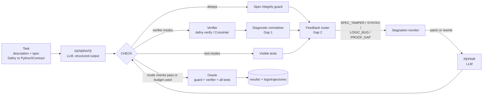

# SpecLoop: verifier and test feedback for LLM code generation

AI4015 Agentic AI, Phase 2 | Group G1 (project code G1-XX) | Supervisor: Muhammad Sajjad

SpecLoop is a small agent that writes a program for a task given a formal specification, checks it with a verifier and with tests, and sends the failures back to the LLM for repair until the checks pass or the attempt budget (5 candidates) is used up. The same loop runs on two specification languages, Dafny and Python with iContract contracts (checked by CrossHair), so the languages can be compared under one controller.

The base paper is VERINA (Ye et al., ICLR 2026), a Lean 4 benchmark of 189 tasks for verifiable code generation. We take its VERINA-BASIC subset (108 tasks), re-express each task in Dafny and in Python/iContract as a pair, and check that the two versions mean the same thing. Our three research gaps (unchanged since Phase 1) are:

* **Gap 1:** nobody has compared specification languages under one controlled agent loop.
* **Gap 2:** repair loops use verifier errors for feedback, and tests only for scoring. They are never combined as feedback.
* **Gap 3:** VERINA has no testing-only baseline, so the value that verifier feedback adds over tests is unknown.

All experiments use `gpt-4o-mini-2024-07-18` because of a hard budget cap (total API spend of $2, enforced in code).

## Architecture



The oracle is not part of the agent. It judges every candidate the same way (spec intact, verified, all visible and held-out tests pass), whatever mode the agent ran in. More detail is in [docs/architecture.md](docs/architecture.md).

| Component | File | Gap | Switch |
|---|---|---|---|
| Multi-backend verification (Dafny, CrossHair) on paired tasks | `src/backends/` | Gap 1 | `--language` |
| Diagnostic normaliser | `src/components/diagnostics.py` | Gap 1 | `normalizer` |
| Test feedback channel + feedback router | `src/components/router.py` | Gap 2 | `mode=combined`, `router` |
| Verifier feedback channel | `src/agents/controller.py` (`AgentMode.uses_verifier`) | Gap 3 | `mode` |
| Spec integrity guard | `src/components/spec_guard.py` | validity of "verified" | `guard` |
| Stagnation monitor | `src/components/stagnation.py` | robustness | `stagnation` |
| Independent oracle | `src/evaluation/oracle.py` | evaluation | always on |

Agent modes (`AgentMode` in `src/schemas.py`): `single_shot`, `testing_only`, `verifier_feedback` (called `verifier_only` in the result tables) and `combined` (the full system).

## Installation

Tested on Windows 10 with Python 3.12. It should work on Linux and macOS, but we did not test there.

```bash
git clone https://github.com/syedhassan13/SpecForge.git
cd SpecForge

python -m venv .venv
source .venv/bin/activate          # Linux / macOS
# .venv\Scripts\activate           # Windows (cmd / PowerShell)

pip install -r requirements.txt
```

**Dafny 4.11.** Download the release for your OS from <https://github.com/dafny-lang/dafny/releases>, unzip it somewhere and put the path to the executable in `DAFNY_PATH` (see the next section). Check it with `dafny --version`. The Python/iContract side only needs the pip packages (`icontract`, `crosshair-tool` 0.0.113 in our runs).

**Benchmark data.** The raw data is not committed (`data/raw/` is git ignored). Rebuild it with:

```bash
python data/scripts/download_data.py     # VERINA parquet from Hugging Face + CloverBench and MBPP-DFY repos
python data/scripts/extract_verina.py    # VERINA-BASIC -> data/raw/verina_basic/*.json (+ skipped.json)
```

The finished tasks (`data/tasks/vb_*.json`) and the split (`data/splits.json`) are already in the repo, so you only need the two commands above if you want to rebuild the benchmark from scratch. Running the experiments does not need them.

## Configuration and environment variables

Copy `.env.example` to `.env` and fill it in. `.env` is git ignored.

| Variable | Required | Meaning |
|---|---|---|
| `OPENAI_API_KEY` | for live runs | OpenAI key. All experiments use `gpt-4o-mini` (pinned to `gpt-4o-mini-2024-07-18`). Not needed with `--offline` and a warm cache. |
| `OPEN_MODEL_NAME` | optional | Name of an open-weight model served through an OpenAI-compatible endpoint (DeepSeek, OpenRouter, Together, Groq, HF router). Use it as `open:<OPEN_MODEL_NAME>` in `--model` / `--models` or in a config file. |
| `OPEN_MODEL_BASE_URL` | optional | Base URL of that endpoint. |
| `OPEN_MODEL_API_KEY` | optional | API key for that endpoint. |
| `OPEN_MODEL_JSON_SCHEMA` | optional | `1` if the endpoint supports JSON-schema structured output, `0` otherwise (default `0`). |
| `DAFNY_PATH` | yes for Dafny | Path to the Dafny executable (default `dafny`, i.e. found on `PATH`). |

**Budget.** `experiments.run` has `--budget` (default 2.0 USD). It counts money already spent in earlier runs and stops launching new runs once the cap is reached.

**LLM cache.** Every LLM response is stored in `cache/llm_cache.sqlite`, keyed by a hash of the full request (model, messages, temperature, seed, sample index, schema). The cache is not committed because it is large. It is provided as a release asset named `llm_cache.sqlite` on the GitHub repository. Put it at `cache/llm_cache.sqlite` and the experiments can be replayed exactly with `--offline`, with no API key and no cost (only the Dafny and CrossHair runs happen locally). Without the cache, the same commands call the API and cost real money (capped by `--budget`), and the model's answers will not be identical to ours.

## How to run

List tasks:

```bash
python specloop.py tasks --split dev        # 20 dev tasks
python specloop.py tasks --split test       # 77 test tasks
```

Run the agent on one task and print its trajectory:

```bash
python specloop.py solve vb_051 --language dafny --model gpt-4o-mini
```

Useful flags: `--language dafny|python`, `--mode single_shot|testing_only|verifier_feedback|combined` (default `combined`), `--max-attempts 5`, `--no-normalizer --no-router --no-guard --no-stagnation`, `--verbose` (full feedback text), `--show-code`, `--trace out.json`.

A shortened trace (binary search task, Dafny, first candidate from the cache):

```
task vb_051_dafny (BinarySearch), model gpt-4o-mini, mode combined

[   0.0s] == GENERATE
[   0.0s]    llm generate: 454+239 tokens (cached)
[   0.0s] == CHECK (attempt 1)
[   0.0s]    tool spec_guard: {'ok': True}
[   2.5s]    tool verify: {'status': 'failed', 'kinds': ['index_bounds', 'postcondition', 'postcondition', 'postcondition']}
[   4.3s]    tool run_tests: {'status': 'passed', 'passed': 3, 'total': 3}
[   5.9s]    oracle: intact=True verified=False tests=5/5 -> not correct
[   5.9s] == ROUTE (attempt 1)
[   5.9s]    router -> PROOF_GAP
[   5.9s] == REPAIR (attempt 1)
...
[  34.5s]    decision: switch_strategy (same failure repeated or program resubmitted)
[  34.5s] == REPAIR (attempt 4)
[  34.5s]    llm rewrite: 1145+402 tokens
...
[  46.7s]    decision: stop (attempt budget used)
[  46.7s] == STOP

result: NOT CORRECT after 5 attempt(s), stop=budget, cost $0.0018
```

This task is a good example of why the router exists: all visible tests pass but the Dafny proof does not go through, so the failure is classified as `PROOF_GAP` (a missing loop invariant) and not as a logic bug. Not every task ends this way, many are solved in one or two attempts.

`specloop.py` also has `run`, `analyze` and `validate` subcommands that call the scripts below.

## Reproducing the experiments

Run all commands from the repository root. Runs are resumable (finished units are skipped). Add `--offline` to any `experiments.run` command to replay from `cache/llm_cache.sqlite` without API calls. Both Dafny and CrossHair must be installed either way.

**Step 0, benchmark checks (once).**

```bash
python data/scripts/validate_tasks.py        # admission checks, writes data/validation_report.json
python data/scripts/check_equivalence.py     # differential test Dafny vs Python, writes data/equivalence_report.json
python data/scripts/make_splits.py           # only if you rebuild the benchmark; rewrites data/splits.json (seed 2026)
```

`make_splits.py` is already run and the split is fixed. Do not re-run it after the test set has been used.

**Experiments.**

| Exp | What it is | Command |
|---|---|---|
| E1 | Baselines: single-shot and testing-only agent | `python -m experiments.run experiments/configs/E1_baseline.json` |
| E2 | Base-paper protocol (VERINA CodeGen: 2-shot, temperature 1.0, 5 samples per task, pass@1 on tests) | `python -m experiments.run experiments/configs/E2_base_paper.json` |
| E3 | Proposed system (SpecLoop full) | `python -m experiments.run experiments/configs/E3_proposed.json` |
| E4 | Gap-wise: adds the verifier-only arm; also reuses E1 and E3 runs | `python -m experiments.run experiments/configs/E4_gaps.json` |
| E5 | Ablation: `no_normalizer`, `no_router`, `no_guard`, `no_stagnation`. Removing the test channel is `verifier_only` (E4), removing the verifier channel is `testing_only` (E1), so those arms are reused. | `python -m experiments.run experiments/configs/E5_ablation.json` |
| E6 | Efficiency and reliability: tokens, cost, latency, tool calls from all runs above, plus the guard stress test | `python -m experiments.guard_stress` then `python -m experiments.analyze` |

Seeds are 0, 1, 2 for E1, E3, E4 and E5, over the 77 test tasks in both languages. Handy options of `experiments.run`: `--only <config names>`, `--models`, `--seeds`, `--workers` (default 12), `--limit N` (smoke run on the first N pairs), `--offline`.

`experiments/configs/dev_iterations.json` is the development run on the dev split only (it0 to it3 in the changes section below). It should not be run on the test split.

**Final step, tables and figures.**

```bash
python -m experiments.analyze
```

**Where the outputs go.**

| Path | Written by | Content |
|---|---|---|
| `results/raw/<exp>/*.jsonl` | `experiments.run` | one row per run (task, config, model, seed, oracle verdict, attempts, tokens, cost, time). E2 writes `verina_protocol__<model>.jsonl` |
| `logs/trajectories/<exp>/*.jsonl.gz` | `experiments.run` (E1, E3, E4, E5) | full trajectory of every run: state transitions, LLM calls, tool calls, routed feedback, decisions, per-attempt oracle verdicts |
| `data/validation_report.json` | `validate_tasks.py` | admission result per task |
| `data/equivalence_report.json` | `check_equivalence.py` | Dafny vs Python agreement on random inputs |
| `results/guard_stress.csv`, `results/guard_stress_summary.json` | `guard_stress` | tampering and benign mutants, guard and verifier verdicts |
| `results/tables/*.csv`, `*.tex` | `analyze` | main results, gap analyses, ablation, reliability tables |
| `results/figures/*.pdf`, `*.png` | `analyze` | `fig_modes`, `fig_curves`, `fig_failures` |
| `results/cases/*.md` | `analyze` | representative trajectories for the failure analysis |
| `results/summary.json` | `analyze` | every number quoted in the paper and in this README |

## Benchmark summary

Full description: [docs/benchmark.md](docs/benchmark.md).

* **Source:** VERINA-BASIC, 108 tasks. Each was translated by the VERINA authors from a Dafny original in CloverBench (59) or MBPP-DFY (49). We write each one again in Dafny and in Python/iContract, using VERINA's Lean pre/postcondition as the meaning of the task and VERINA's positive tests as our tests.
* **Extraction:** 11 tasks were left out because their types have no clean equivalent in both languages (Float, Option, Map, UInt8, higher-order arguments, nested arrays) or because the VERINA record is malformed. That leaves 97 tasks (`data/tasks/vb_*.json`, listed in `data/raw/verina_basic/skipped.json` for the skipped ones).
* **Validation:** a task is admitted only if, in both languages, (1) the reference passes the spec guard, (2) it verifies (Dafny) or CrossHair finds no counterexample (Python), (3) it passes every test, (4) the empty stub is rejected, and (5) spec probes pass: for every test input the spec accepts VERINA's expected output and rejects VERINA's wrong outputs. `check_equivalence.py` adds a second, independent differential test on random inputs.
* **Split:** fixed 20 dev / 77 test, drawn once with seed 2026 (`data/splits.json`). Dev is used for prompt and component decisions and for the two worked examples of E2. Test is only used for the final experiments.
* **Visible and held-out tests:** the agent only sees the visible tests. The oracle runs all tests.

CrossHair is a bounded checker, so "verified" on the Python side means no counterexample within the time budget. This is weaker than a Dafny proof, and it matters when reading the Gap 1 results.

## Results

<!-- RESULTS:START -->

All numbers come from `results/summary.json` (built by `python -m experiments.analyze`) and are the same numbers that appear in the paper.

**Main table** (77 test tasks per language, gpt-4o-mini-2024-07-18, mean ± s.d. over 3 seeds, correct = spec intact AND verified AND all tests pass)

| System | Dafny correct | Python/iContract correct | Dafny avg. candidates | Dafny cost per run (USD) | Dafny false success |
|---|---|---|---|---|---|
| Single-shot (E1) | 46.8 ± 1.3 | 96.5 ± 0.7 | 1.00 | 0.00021 | 0% |
| Testing-only agent (E1) | 56.3 ± 2.7 | 97.8 ± 0.7 | 1.97 | 0.00052 | 26.8% |
| Verifier-only agent (E4) | 63.2 ± 2.0 | 98.7 ± 0.0 | 2.74 | 0.00079 | 0% |
| **SpecLoop full (E3)** | **68.0 ± 2.7** | **98.7 ± 0.0** | 2.65 | 0.00078 | 0% |

False success = the agent stopped because its own checks passed, but the oracle rejects the program (for the testing-only agent: all tests pass, program does not verify).

**Base paper vs reproduction (E2, single attempt, pass@1)**

| Setting | Pass all tests | Do not compile | Verified | Correct |
|---|---|---|---|---|
| VERINA, Lean (reported, Table 9 of the paper) | 44.0 | 54.9 | n/a | n/a |
| VERINA protocol on our Dafny tasks (reproduced) | 69.3 | 26.4 | 49.8 | 49.8 |
| VERINA protocol on our Python tasks (reproduced) | 98.7 | 0.0 | 97.0 | 94.8 |

**Ablation (E5, Dafny, change in correctness vs full SpecLoop, pp, Wilcoxon p):** no verifier channel -11.7 (p=0.002), no normaliser -6.9 (p=0.010), no dev-iteration fixes -6.5 (p=0.011), no test channel -4.8 (p=0.081), no router -3.0 (p=0.25), no stagnation monitor -1.3 (p=0.10), no in-loop guard 0.0.

**Integrity guard stress test (E6):** the guard rejects 591/591 Dafny and 485/485 Python tampering mutants and 0/388 harmless ones. Without it, Dafny alone would have accepted 529 of the 591 tampered programs.

**Gap resolution**

| Gap | Method / component | Metric | Base paper result | Our result | Addressed? (Fully / Partially / Not) |
|---|---|---|---|---|---|
| Gap 1: no controlled comparison of specification languages | Same tasks in Dafny and Python/iContract (probe-checked, differential-tested), multi-backend verification, diagnostic normaliser | CodeGen pass@1; correctness | Lean: 44.0% pass@1, 54.9% do not compile (reported) | Pass@1 Dafny 69.3%, Python 98.7%; SpecLoop correct Dafny 68.0% vs Python 98.7% (-30.7 pp, p<0.001) | **Fully** (H1a refuted, H1b supported) |
| Gap 2: verifier errors and tests never combined as feedback | Test channel + feedback router (LOGIC_BUG vs PROOF_GAP) | Correctness vs best single source | Not studied (single-shot only) | SpecLoop 68.0% vs verifier-only 63.2% (+4.8 pp, 95% CI [0.9, 9.1], McNemar p=0.043, Wilcoxon p=0.081); 39% of failed verifications were on code that passed every test | **Partially** (gain just below the 5 pp target) |
| Gap 3: no testing-only baseline in VERINA | Verifier feedback channel vs identical testing-only agent | Correctness gain; false-success rate | No testing-only baseline | +6.9 pp (95% CI [2.6, 11.7], p=0.008); testing-only stops on unverified code in 26.8% of Dafny runs, verifier-based agents in 0% | **Partially** (gain below the 10 pp target; one model) |

Total API spend for the whole study (dev runs, E1-E5): about 1.04 USD.

<!-- RESULTS:END -->

## Changes since Phase 1

* **Benchmark rebuilt.** Phase 1 had 7 hand-written tasks (5 Dafny, 2 Python) that were not paired, so the language comparison was not controlled. The Phase 2 benchmark is built from VERINA-BASIC: 97 extracted tasks, each in both languages, with validation (guard, verification, tests, non-vacuous spec, spec probes) and an independent equivalence check.
* **Dafny tests did nothing in Phase 1.** The Phase 1 Dafny test cases used `assert`, which is ghost code and is erased at run time, so they never checked anything. They are replaced by a runtime harness (`src/tasks/harness.py`) that compiles a `Main` method and reports a PASS/FAIL line per test case.
* **Visible and held-out tests.** The agent sees a subset of the tests. The oracle uses all of them, so a candidate cannot pass by overfitting to the visible cases.
* **One controller instead of four agent classes.** Phase 1 had four agent classes with copy-pasted loops. Now there is one controller (`src/agents/controller.py`) with switchable components. `src/agents/coding_agent.py` only keeps the old mode names as presets.
* **Spec guard rewritten.** The Phase 1 guard compared regex-matched clauses line by line. It missed edits to helper predicates and escape hatches such as `assume` and `{:verify false}`. The new guard (`src/components/spec_guard.py`) compares the whole specification part of the program and rejects escape hatches. `experiments/guard_stress.py` tests it with tampering and benign mutants.
* **New components.** Diagnostic normaliser, feedback router, stagnation monitor, independent oracle, trajectory logging (`logs/trajectories/`) and the LLM response cache.
* **Models.** Phase 1 planned GPT-4o and Claude Sonnet. Phase 2 uses `gpt-4o-mini-2024-07-18` for every experiment because of the $2 budget cap, with an optional open-weight model through the `OPEN_MODEL_*` variables. The Anthropic provider was dropped.
* **Gap 3 research question rewritten** to match the gap (supervisor feedback): it now asks what verifier feedback adds over a testing-only baseline, instead of comparing models.
* **Packaging.** `setup.py` is replaced by `pyproject.toml`.

Development iterations on the dev split (it0 Phase 1 style loop, it1 + normaliser, it2 + router, it3 + stagnation monitor) are in `experiments/configs/dev_iterations.json`.

## Repository structure

```
SpecForge/
├── specloop.py               CLI: solve, tasks, run, analyze, validate
├── src/
│   ├── schemas.py            data contracts (AgentMode, Language, results)
│   ├── pipeline.py           experiment runner (thread pool, budget, resumable)
│   ├── agents/               controller.py (state machine), prompts.py, coding_agent.py (Phase 1 presets)
│   ├── backends/             dafny_backend.py, python_contract_backend.py (CrossHair)
│   ├── components/           diagnostics.py, router.py, spec_guard.py, stagnation.py
│   ├── evaluation/           oracle.py, stats.py, verina_protocol.py (E2), evaluator.py
│   ├── providers/            llm_provider.py (OpenAI-compatible + mock), cache.py (SQLite)
│   ├── tasks/                loader.py, harness.py (test harness), types.py (neutral types)
│   └── tracing/              trajectory.py
├── experiments/
│   ├── run.py                run one experiment config
│   ├── analyze.py            tables, figures, summary.json
│   ├── guard_stress.py       guard stress test (E6)
│   └── configs/              E1 to E5 configs + dev_iterations.json
├── data/
│   ├── tasks/                97 paired tasks, vb_XXX.json
│   ├── splits.json           fixed 20 dev / 77 test split (seed 2026)
│   ├── scripts/              download_data, extract_verina, make_splits, validate_tasks, check_equivalence
│   └── raw/                  downloaded data, git ignored
├── docs/                     architecture.md, benchmark.md, Phase1_G1_Report.tex
├── paper/                    LaTeX sections and figures
├── results/                  raw/, tables/, figures/, cases/, summary.json
├── logs/                     trajectories/ and run logs
├── cache/                    llm_cache.sqlite (not committed, see release asset)
├── tests/                    test_pipeline.py
├── run_baseline.py               Phase 1 entry point, now a thin wrapper that runs E1
├── docs/phase1/                  Phase 1 report source and the original 7 tasks (kept for reference)
├── pyproject.toml, requirements.txt, pytest.ini, .env.example
└── README.md
```

## Tests

```bash
python -m pytest
```

Currently all 37 tests pass (`.venv/Scripts/python.exe -m pytest -q`, with Dafny installed and `DAFNY_PATH` set in `.env`). The suite covers the neutral types, harness generation, the Dafny and Python spec guards, the diagnostic normaliser, the router, the stagnation monitor, response parsing and pricing, and the task splits. The Dafny integration tests are skipped automatically when Dafny is not installed. No API key is needed.

## Team and contributions

| Member | ID | Contributions |
|---|---|---|
| Syed Muhammad Hassan (group head) | 23i-0519 | Pipeline architecture, Dafny backend, agent controller, router and normaliser, CLI, integration |
| Abdul Majeed | 23p-3038 | Python/iContract backend, CrossHair integration, benchmark construction and validation, equivalence and guard stress tests, experiments and analysis, paper |

## License

MIT (see `pyproject.toml`).

## Acknowledgments

Base paper: Ye et al., *VERINA: Benchmarking LLMs on Verifiable Code Generation*, ICLR 2026. Task sources: CloverBench and MBPP-DFY (Dafny). Tools: Dafny, CrossHair, icontract.
