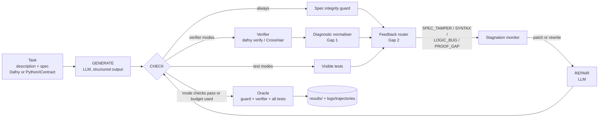

# SpecLoop architecture

## Components and the gap each one addresses

| Component | File | Gap | Switch |
|---|---|---|---|
| Multi-backend verification (Dafny, CrossHair) on paired tasks | `src/backends/` | Gap 1 | `--language` |
| Diagnostic normaliser | `src/components/diagnostics.py` | Gap 1 | `normalizer` |
| Test feedback channel + feedback router | `src/components/router.py` | Gap 2 | `mode=combined`, `router` |
| Verifier feedback channel | `src/agents/controller.py` (`AgentMode.uses_verifier`) | Gap 3 | `mode` |
| Spec integrity guard | `src/components/spec_guard.py` | validity of "verified" | `guard` |
| Stagnation monitor | `src/components/stagnation.py` | robustness | `stagnation` |
| Independent oracle | `src/evaluation/oracle.py` | evaluation | always on |

## State machine

`START -> GENERATE -> CHECK -> (STOP | ROUTE -> REPAIR -> CHECK ...) -> STOP`

* **CHECK** runs the guard first. A tampered program is not sent to the
  verifier at all; the model is told what it changed.
* **ROUTE** classifies the failure:
  * `SPEC_TAMPER` the spec was edited or an escape hatch was used
  * `SYNTAX` the program does not compile
  * `LOGIC_BUG` a test fails or CrossHair found a counterexample
  * `PROOF_GAP` all visible tests pass but the verifier still rejects the program
  * `VERIFY_FAIL` the verifier rejects and there is no test evidence (verifier-only mode)
* **REPAIR** asks for a patch, or for a rewrite when the stagnation monitor
  sees the same failure twice in a row or a resubmitted program.
* **STOP** when the checks of the current mode pass or after 5 candidates.

The oracle is not part of the agent. It judges every candidate with the guard,
the verifier and the full test set (visible + held-out) so all modes are
scored the same way.

## Observability

Every run writes a trajectory (`logs/trajectories/<experiment>/*.jsonl.gz`)
with state transitions, LLM calls (tokens, the model's own analysis and
chosen strategy, the code), tool calls (input hash, status, errors, time),
routed feedback, decisions and per-attempt oracle verdicts. `python
specloop.py solve <task>` prints the same trajectory for a single run.
